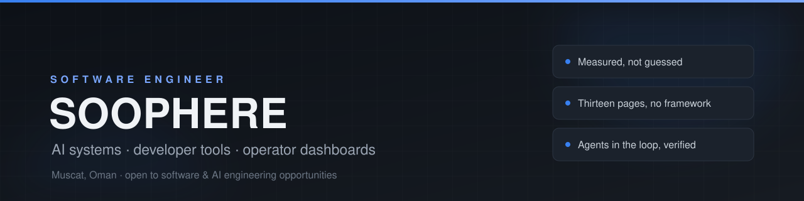

  

 

**I build operator-grade software and use coding agents as a real engineering tool — with harnesses,
captured payloads and verification, not vibes.**

Based in Muscat, Oman. I like problems where the numbers have to be honest: dashboards that operate
live money, fleets of AI models that may or may not actually answer, memory that survives the next
chat window.

## Selected work

<table>
<tr>
<td width="50%" valign="top">
<h3>Pulse Desk</h3>

<b>Operator dashboard for an automated crypto trading desk.</b> Thirteen pages, per-method
controls, an AI council, wallet tracking and an honest history — with paper and live money kept
strictly apart.

Vanilla HTML/CSS/JS and canvas. No framework, no build step. A Node harness renders every page
against captured live API payloads, and the UI swaps over SSH without restarting the trading
process.

<a href="https://soophere.github.io/pulse-desk-ui/"><b>▶ Live interactive demo</b></a> ·
<a href="https://github.com/Soophere/pulse-desk-ui">repo</a> · MIT

</td>
<td width="50%" valign="top">
<h3>The City</h3>

<b>A free-only fleet of AI workers, routed by job instead of by model.</b> Probed all 82 free
models the account listed, kept the 17 that actually answered, and routed jobs across
latency-measured pools with per-worker patience, retries, cooldowns and fallbacks.

Mixture-of-agents chat on top, build log included: what broke, what the catalog was lying about,
and why per-worker timeouts beat one global number.

<a href="https://github.com/Soophere/the-city"><b>repo</b></a> · MIT

</td>
</tr>
<tr>
<td width="50%" valign="top">
<h3>agent-memory</h3>

<b>Persistent memory for AI coding agents.</b> A plain-markdown bank plus a zero-dependency
Node CLI: it loads your profile, project notes, decisions and recent sessions before the first
reply, and saves what matters as one-line facts during work.

Built for DeepSeek Harness, used daily across 40+ sessions in 21 folders — because losing
context should be an engineering problem, not a personality trait.

<a href="https://github.com/Soophere/agent-memory"><b>repo</b></a> · MIT

</td>
<td width="50%" valign="top">
<h3>CS2 skin sniper</h3>

<b>Local dashboard + Discord alerter that hunts under-market Counter-Strike 2 items across eight
markets.</b> A multi-market price book, rate-limit-safe polling, anti-fake-profit guards,
urgency-tiered alerts and rejection telemetry.

FastAPI + asyncio behind a custom dashboard; no auto-buy — it surfaces the edge and links the buy,
the operator decides. The guard rules are documented in the README.

<a href="https://github.com/Soophere/cs2-sniper"><b>repo</b></a> · MIT

</td>
</tr>
</table>

## Track record

**Jul → Sep 2026:** from course basics to a live multi-engine trading desk, a public market
scanner, and my own AI tooling — built in long AI-assisted sessions and verified on running
systems, not notebooks.

- **Pulse Desk — engine and safety layer.** The public UI is the face; behind it I built and
  operated the desk itself: Core / Wish / Moonshot / On-chain Alpha engines with paper and live
  paths kept strictly separate, one-live-engine-per-coin-class locks, on-chain safety guards
  (honeypot probe, token-account rent reclaim, gas guard, rug filters), an AI council with a
  throttle and budget, a position ledger reconciled against the chain, and fill-vs-quote accounting.
  Each change was verified against live data before it shipped.
- **AI infrastructure.** Before DeepSeek Harness I ran my own AI stack: a fleet of free model
  workers ([The City](https://github.com/Soophere/the-city)), an OpenAI-compatible router, MCP
  servers, and agent skills that later became [agent-memory](https://github.com/Soophere/agent-memory).
- **AI-assisted engineering, measured.** 21 AI-attributed commits in a ten-week stretch
  (+41,861 / −902 lines, 186 files) across the desk and the sniper. Attribution comes from the IDE's
  code-tracking database, and every commit was reviewed and tested against a running system — the
  harness is what makes it my code.

## Toolbox

Also: vanilla DOM and canvas (no chart libraries), LiteLLM / OpenAI-compatible routing, DSH plugins and
skills, static deployment over SSH, Windows native builds with clang-cl.

## How I work

1. **Measure before believing.** Model rosters come from probes; UI numbers come from captured
   payloads; "it works" means a harness says so.
2. **Make failure visible.** An offline dashboard must say it is offline. A silent model must be
   recorded as silent, not as a success.
3. **Keep the tooling boring.** Markdown over databases. Static files over build pipelines. One
   shell and two modules over a framework migration.
4. **Let agents do the typing, keep the verification.** AI writes code fast; the harness is what
   makes it my code.

## Learning (Udemy)

Structured learning alongside building. Currently working through:

- **The Complete Full-Stack Web Development Bootcamp** (Dr. Angela Yu) — HTML/CSS/JavaScript, React,
  Node, PostgreSQL, Web3 / DApps.
- **Java Masterclass 2025** (Tim Buchalka) — core Java, OOP, collections, generics, streams,
  concurrency, Java 17.
- **100 Days of Code: The Complete Python Pro Bootcamp** (Dr. Angela Yu) — Python, automation,
  Flask, APIs, pandas/NumPy, Selenium/BeautifulSoup, GUIs.
- **Mastering Linux: The Comprehensive Guide** (Jannis Seemann, Denis Panjuta) — CLI, filesystem
  and permissions, processes, packages, Bash scripting, networking.
- **Ethical Hacking & Penetration Testing from Scratch** (Ahmed zoala, Arabic) — reconnaissance,
  MITM/DNS spoofing, packet capture, Metasploit fundamentals.

All in progress. What each covers, and where the skills show up in my projects:
[LEARNING.md](LEARNING.md).

## Current focus

- Pulse Desk: the operator dashboard above, in daily use on my home lab.
- Expanding The City with a dispatcher that hedges slow workers and verifies answers across models.
- Open to **software engineering / AI engineering** roles — the easiest way to reach me is here on
  GitHub.

 

  Built with <a href="https://github.com/deepseek-ai/deepseek-harness">DeepSeek Harness</a> as the coding agent — verified end to end.

